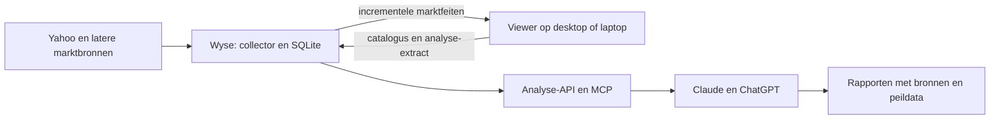

# Plan: Wyse-dataservice, portefeuille-extracten, synchronisatie en AI-analyse

**Datum:** 25 oktober 2026. **Status:** bouwplan; de serverdienst is nog niet geïmplementeerd.
**Applicatie:** Portefeuille Viewer 1.6. **Omvang:** circa zes tekstpagina's;
Markdown heeft geen vaste paginering. Dit document legt de beoogde oplevering,
technische keuzes, uitvoering en acceptatie vast.

## 1. Doel, werkwijze en afbakening

### Het te leveren resultaat

De Dell Wyse thuis wordt een permanent beschikbare dienst die financiële
marktgegevens verzamelt, historische veranderingen bewaart en een gerichte
analysedataset beschikbaar stelt. Portefeuille Viewer blijft het systeem voor
administratie en portefeuilleberekeningen. De app kan thuis of buitenshuis de
nieuwe marktgegevens ophalen en een actueel portefeuille-extract aanleveren.
Claude en ChatGPT kunnen vervolgens via gecontroleerde leesfuncties marktfeiten
en portefeuille-uitkomsten combineren voor analyses en rapportages.

Het concrete eindbeeld is: in de ochtend is de marktinformatie bijgewerkt,
kan een assistent vaststellen welke gebeurtenissen of wijzigingen relevant zijn,
en kan de gebruiker in de app of via de assistent verder onderzoeken. Dit geldt
ook voor assets zonder positie, bijvoorbeeld om een mogelijke instap te beoordelen.

Het volledige inhoudelijke eindbeeld is uitgewerkt in
[Bijlage: zeven onderdelen van de markt- en portefeuillebriefing](roadmap_volledige_markt_en_portefeuillebriefing_7_onderdelen.md).
Deze bijlage koppelt alle door de gebruiker genoemde onderwerpen aan benodigde
data, technische voorbereiding, ontbrekende bronnen en latere opleverfasen.
De eerste serveroplevering is de fundering; zij levert nog niet automatisch
alle zeven onderdelen volledig. De bijlage maakt deel uit van dit plan.

### Aansluiten op de bestaande administratie

Er is één menselijke gebruiker, met profielen Onno, Muriel en Quinten. Desktop
en laptop worden doorgaans niet tegelijk gebruikt. De Access-bestanden worden
via OneDrive gesynchroniseerd voordat de app op de andere computer wordt geopend.
Nieuwe transacties worden in Portefeuille Viewer geadministreerd; daarbij kan de
app meteen nieuwe extracten laten volgen op de voltooide herberekeningen.

Assignments van de afgelopen nacht kunnen nog ontbreken totdat de administratie
is bijgewerkt. De server verzint daarvoor geen posities. Analyses tonen de
administratieve peildatum en noemen ontbrekende of oude waarnemingen. Een recente
Yahoo-update maakt een oudere portefeuille-export niet vanzelf actueel.

### Verdeling van verantwoordelijkheid

| Gegevens | Leidende partij | Richting |
|---|---|---|
| Assetcatalogus, symbolen en handmatige classificatiekeuzes | App/STOCKDATA | App naar Wyse |
| Yahoo-feiten, bronantwoorden, ophaalstatus en wijzigingshistorie | Wyse-collector na omschakeling | Wyse naar STOCKDATA |
| Transacties en daaruit berekende posities/resultaten | App/userdatabase | Alleen relevante uitkomsten naar Wyse |
| IBKR-prijzen, beschikbare Greeks/IV en dividendwaarnemingen | App/IBKR | Extract naar Wyse |
| Berekende asset-indicatoren | App/STOCKDATA | Resultaten en beperkte historie naar Wyse |
| Analyses en rapporten | Analyselaag | Beschikbaar voor app en assistent |

Er worden geen volledige Access-bestanden of ruwe transactietabellen op de Wyse
geplaatst. Posities, lifetime-resultaten en indicatoren worden daar niet opnieuw
uit transacties gereconstrueerd. Wel mogen analyses op de aangeleverde resultaten
worden uitgevoerd, zoals gebeurtenissen koppelen aan opties met een nabije expiratie.

De eerste oplevering omvat Yahoo-verzameling, serveropslag, veilige synchronisatie,
portefeuille-extracten en een leesbare analyse-interface. Een uitgebreide kalender-
UI, eigen macrodataproviders, nieuwsverzameling, relatieve marktindicatoren en
autonome tradingbeslissingen zijn vervolgwerk. De structuur moet die uitbreiding
wel ondersteunen zonder alles aan één asset of één databron vast te zetten.

## 2. Bestaande omgeving en technische architectuur

### Gecontroleerde uitgangssituatie

| Onderdeel | Huidige situatie, gecontroleerd op 25 oktober 2026 |
|---|---|
| Ontwikkelcomputer | Windows; project `C:\python_coding\portefeuille_viewer\portefeuille_viewer_1.6` |
| App-runtime | Python 3.11.7; PySide6/Qt 6.9.3; pyodbc 5.0.1 |
| Bestaande Yahoo-adapter | Getest met `yfinance==1.7.0` |
| Server | `homeserver1`, bereikbaar als `onno@192.168.2.160` |
| Server-OS | Ubuntu 26.04.1 LTS, x86_64; kernel `7.0.0-38-generic` |
| Host-Python | Python 3.14.4; de nieuwe dienst krijgt een eigen container-runtime |
| Hardware | Intel Celeron J4105, 4 cores; circa 7,1 GiB RAM |
| Capaciteit | Circa 195 GB schijf vrij en 5 GiB beschikbaar geheugen bij controle |
| Containers | Docker 29.9.0; Docker Compose v5.6.0 |
| Bestaande diensten | Home Assistant, OTBR, Matter, Grafana, InfluxDB en Uptime Kuma |
| Toegang | Werkende aparte SSH-sleutel; gebruiker `onno` heeft Docker-toegang |

De SSH-privésleutel staat op Windows onder de gebruikersmap, buiten Git, en heeft
momenteel geen wachtzin. In dit plan komen geen sleutelinhoud, tokens of wachtwoorden.
SSH is de beheerverbinding, niet de synchronisatiemethode voor de uiteindelijke app.

### Dienst en opslag

Voor deze omvang is één Python-dataservice met FastAPI en SQLite een passende
start. Een centrale SQL-server, Redis of Celery is voor de eerste versie niet nodig.
API en planner kunnen in één container draaien met **één Uvicorn-worker**; meerdere
webworkers zouden anders onbedoeld meerdere collectors starten. Netwerkophaling
loopt buiten de API-eventloop en buiten database-transacties, in een eigen werkpad.

SQLite staat op de lokale Wyse-schijf, met WAL, expliciete transacties, een
busy-timeout en één geserialiseerde schrijfroute. Leesverbindingen blijven aan
hun eigen thread gebonden. Gegevensvalidatie en bronparsing gebeuren vóór een
schrijftransactie. Een grotere upload wordt eerst gevalideerd en daarna atomair
actief gemaakt. Dit voorkomt dat een langzame Yahoo-aanvraag appuploads blokkeert.

De Docker-container gebruikt aanvankelijk een op Python 3.11 gebaseerde, vastgezette
Linux-image. De host-Python en andere containers blijven ongemoeid. Dependencies
worden na de Linux-proef vastgelegd; `yfinance` en `curl_cffi` moeten op x86_64
daadwerkelijk in de image werken. PySide6, pyodbc en de Windows Access-driver
horen niet in deze container.

Voorgestelde servermap: `/home/onno/portefeuille-data-service`, bij controle nog
niet aanwezig. Daaronder komen `deploy/`, `data/`, `backups/` en afgeschermde
runtimeconfiguratie. De broncode blijft in Git; data, secrets en backups niet.
Een eigen Compose-project voorkomt naamconflicten. Er wordt geen Docker-socket
in de dienst gemount en geen hostnetwerk gebruikt.

Beginwaarden voor begrenzing: maximaal één CPU-core, 1 GiB geheugen en begrensde
logs. Dit zijn te toetsen startinstellingen, geen gemeten verbruiksgaranties.
Zet rekenbibliotheken aanvankelijk op één thread. Controleer tijdens de pilot
ook de invloed op Home Assistant. De dienst herstart automatisch na een reboot.

## 3. Gegevensmodel en hergebruik van de bestaande code

### Wat blijft bruikbaar

De huidige `financial_data_contract.py`, `yahoo_financial_provider.py` en
normalisatie van feiten vormen de basis. Het framework onderscheidt al bron,
onderwerp, categorie, metric, periode, valuta, eenheid, grondslag en versies.
Ook de voorzichtige vergelijkingen tussen consensus en actuals zijn bruikbaar.
De huidige Access-repository en Windows-lease/plannerkoppelingen moeten worden
losgemaakt; de bestaande code is dus geen kant-en-klare Linux-service.

Maak een platformonafhankelijke kern met een repositorycontract voor onder andere
catalogus, fetch-states, feiten lezen en een resultaat atomair opslaan. Bouw
daarnaast een SQLite-adapter. De kern importeert geen Qt, Windows-locks of
appconfiguratie. De netwerkadapter ontvangt cachelocatie en instellingen expliciet.
De bestaande inhoudelijke tests blijven de referentie voor beide backends.

Bewaar minimaal: `instruments`, `instrument_mappings`, `financial_facts_current`,
`financial_facts_history`, `financial_fetch_state`, `source_observations`,
`change_feed`, `profile_snapshots`, `profile_snapshot_items`, `indicator_exports`,
`sync_clients`, `upload_receipts` en een expliciete `schema_migrations`-registratie.
Dit zijn voorgestelde servertabellen; definitieve DDL volgt per bouwfase.

Maak stabiele identiteiten met een `dataset_id`, profiel-ID en instrument-ID.
De bestaande STOCKDATA-`Id` kan binnen dezelfde dataset een lokale mapping vormen.
Tickers en displaynamen zijn wijzigbare attributen. De huidige financiële
factsleutels en subjectnamen worden bij de eerste import behouden of expliciet
gemapt, niet stilzwijgend vervangen. Een assetnaamwijziging vraagt een alias/mapping.

### Yahoo-classificatie zonder portefeuillelogica te wijzigen

ETF's zoals XLV en SPY blijven in `asset_rollup_data.type` als `aandeel` behandeld
worden. Voor posities, assignment en resultaatberekening verandert dat niet.
Voorgestelde aanvullende kolommen zijn `yfinance_quote_type`,
`yfinance_quote_type_source` en `yfinance_quote_type_checked_at`. Deze zijn nog
niet toegevoegd; ze vragen een afzonderlijke gecontroleerde STOCKDATA-migratie.

Yahoo-classificatie wordt eerst opgehaald en als bronwaarneming bewaard. De
collector gebruikt een gegevensgroepmatrix: bij ETF's wel geschikte koers-,
dividend- en fondsgegevens, geen bedrijfs-EPS/omzet/earningsaanvragen. Ontbrekende
classificatie blijft onbekend. Een 404 voor één groep sluit een instrument niet
voor alle groepen uit. Handmatige classificaties uit de app hebben voorrang en
worden niet automatisch overschreven. Classificatie-updates worden gebundeld
naar STOCKDATA geïmporteerd, zodat geen refreshgolf per afzonderlijk asset ontstaat.

### Inhoud van het portefeuille-extract

| Blok | Minimaal aan te leveren |
|---|---|
| Manifest | Dataset/profiel, snapshot-ID, administratierevisie, berekeningsgeneratie, sessie/apparaat, schemaversie, aantallen en hash |
| Posities | Instrument, assetklasse, broker/accountalias, aantal/richting, multiplier, valuta, kostprijs en beschikbare waardering |
| Optiecontract | Underlying, expiratie, strike, call/put, series-ID en indien beschikbaar conId/trading class |
| Marktwaarneming | Prijs, bid/ask, bron, prijssoort, live/delayed/frozen/onbekend en afzonderlijke waarnemingstijden |
| Optiemetingen | Beschikbare IV, delta, gamma, theta en vega; overige waarden alleen als werkelijk beschikbaar |
| Indicatoren | Laatste uitkomst en selecteerbare historie, historische peildatum en berekeningsversie |
| Samenvattingen | Berekende blootstelling, concentratie en relevante resultaatcijfers, indien beschikbaar |
| Datakwaliteit | Ontbrekende velden, veroudering en onvolledige berekeningen |

Beta wordt apart benoemd met bron/berekeningswijze; niet als standaard optie-Greek
of gegarandeerd IBKR-veld gepresenteerd. Leg per Greek vast of het een contract-
of positiewaarde is en welke multiplier/eenheid geldt. IV als fractie of percentage,
FX-peildata en prijsgrondslag moeten expliciet zijn. Een ontbrekende waarde is
null, niet nul. De bestaande optie-naamformatter uit de app levert displaynamen.

Alle profielen zijn strikt gescheiden. De export ondersteunt ook futures, cash
en sprinters waar die in de actuele portefeuille voorkomen. De asset-indicatoren
kunnen het hele catalogusuniversum omvatten. Als startbeleid bewaren we de laatste
30 inhoudelijk gewijzigde indicatorresultaten per asset; dat aantal wordt instelbaar.

## 4. Collector, synchronisatie en versiebeheer

### Continu beschikbaar, gedoseerd ophalen

De planner draait permanent, maar vraagt niet elk veld voortdurend opnieuw op.
Neem de bestaande dagcadans als uitgangspunt: gewone gegevens dagelijks,
analisteninformatie ongeveer ieder uur, earnings dichter bij publicatie vaker.
Controleer periodiek welke jobs vervallen zijn; verwerk per bron begrensde rondes
met maximaal enkele minuten werk, bijvoorbeeld 200 gegevensgroepen. Dit zijn
startwaarden die tijdens de pilot op doorlooptijd worden bijgesteld.

Elke job heeft een duurzaam checkpoint. Bij een herstart worden alleen nog
verschuldigde of mislukte groepen opgepakt. Gebruik één actieve collector,
expliciete timeouts, backoff en bronbrede afkoeling bij rate-limits. Geen browser-
omzeilingen of onbeperkt parallel ophalen. Registreer `ok`, `no_data`,
`not_applicable`, `missing_mapping` en `error` afzonderlijk. Een ongewijzigd
feit krijgt geen nieuwe inhoudelijke historie; controletijdstippen blijven apart.

### API-contract

Gebruik versieerbare JSON-contracten onder `/api/v1`. Als startontwerp:

| Endpoint | Functie |
|---|---|
| `GET /health/live` en `/health/ready` | Proces- en opslaggereedheid, minimale publieke inhoud |
| `POST /api/v1/catalog/batches` | Versiegebonden catalogusupdates van de app |
| `GET /api/v1/changes?after=...&limit=...` | Geordende, gepagineerde marktwijzigingen |
| `POST /api/v1/profiles/{id}/snapshots` | Volledig, gevalideerd analyse-extract |
| `GET /api/v1/uploads/{id}` | Ontvangstbewijs na een verbroken uploadverbinding |
| `GET /api/v1/analysis/...` | Begrensde gecombineerde leesmodellen |

Veranderde feiten, revisies en change-feedregels worden in één servertransactie
geschreven. De app importeert een batch via zijn STOCKDATA-worker en bewaart
het ontvangen cursorpunt pas in dezelfde commit. Identieke herhaling is veilig
door unieke sleutels op bron/feit/revisie en upload-ID/hash. De server verstrekt
een eigen geordend volgnummer; een Windows-kloktijd bepaalt niet de volgorde.

Maak een expliciete bootstrap wanneer een client nieuw is of zijn cursor te oud
is. Een oude cursor geeft een duidelijke resyncstatus, geen onzichtbare gaten.
Verwijderen/uitzetten van een catalogusitem gebeurt expliciet; ontbrekende velden
of een gedeeltelijk netwerkantwoord wissen geen bestaande gegevens.

### Een consistente portefeuillestand publiceren

De app maakt een snapshot na de eerste voltooide berekening en na iedere
administratieve wijziging zodra de vervolgcalculaties klaar zijn. Bundel snelle
wijzigingen kort. Marktwaarnemingen/Greeks kunnen daarnaast bijvoorbeeld iedere
60 seconden worden ververst zolang de app actief is; dit wordt instelbaar.
Gebruik bestaande snapshot-capture/freeze-mechanismen: serialization en upload
gaan buiten de UI-thread. Vermijd een export halverwege een state-engine-run.

Een upload is een complete portefeuille, inclusief het bewust verwijderen van
een gesloten positie. De server valideert manifest, hash, aantallen en verplichte
velden en activeert de nieuwe snapshot atomair. Een ontvangen deelpakket wordt
niet zichtbaar als de nieuwste portefeuille. Bewaar voor bronblokken hun eigen
peildatum; een recente koers is geen bewijs van een recente administratie.

Er komt een lokale, duurzame outbox per computer, buiten Git en buiten de
gedeelde OneDrive-databasebestanden. Ontvangstbevestiging, retries en upload-ID's
maken onderbroken netwerkverbindingen hervatbaar. Fouten veranderen niets aan
de geadministreerde transacties. Afsluiten doet een begrensde laatste poging;
resterend werk blijft staan voor de volgende sessie.

### Desktop/laptop en oude uploads

Een gedeelde profielrevisie en lineage-ID zijn nodig. Voorgestelde uitvoering:
een kleine `sync_export_state`-metadatatabel per userdatabase, waarvan de
administratierevisie binnen dezelfde transactie als een administratieve mutatie
wordt verhoogd. Deze metadata reist mee via OneDrive, zonder transacties te
dupliceren. Dit is een afzonderlijke schematoevoeging die vóór implementatie
expliciet wordt uitgewerkt en gemigreerd.

De server combineert deze revisie met een sessiegeneratie en een gecontroleerde
handover per profiel. Een nieuwe laptop vraagt de serverstand op en toont een
conflict als zijn administratie achterloopt; hij overschrijft die niet zomaar.
Updates met dezelfde administratierevisie maar nieuwere quotes horen alleen bij
de actieve exportsessie. Een oude desktop-outbox kan dan geen recente laptop-
snapshot vervangen. Backups terugzetten vereist een bewuste lineage-/herstelactie.

## 5. Bereikbaarheid, analyse-interface en dagelijks beheer

### Intern en extern gebruik

Begin met een loopback-binding op de Wyse, bijvoorbeeld `127.0.0.1:18180` naar
containerpoort 8000. Poort 18180 was vrij bij controle. De eerste ontwikkeltest
gebruikt SSH-portforwarding. Daarna krijgt de service een eigen HTTPS-hostnaam
onder het domein van de gebruiker, bereikbaar via een Cloudflare Tunnel. Deze
maakt een uitgaande verbinding; router-portforwarding voor de dataservice is
niet nodig. De bestaande Home Assistant-toegang blijft afzonderlijk bestaan.

Hetzelfde HTTPS-adres kan thuis en op publiek internet worden gebruikt. Daarmee
is thuisgebruik nog niet onafhankelijk van internet. Een directe LAN-route met
eigen TLS-gateway en eventueel split-DNS kan later worden toegevoegd als dat
vereist blijkt. Authenticatie moet in beide gevallen in de applicatielaag blijven
werken, ook wanneer verkeer niet via Cloudflare Access komt.

De bestaande Cloudflare-/GitHub-inlog is door de gebruiker beschreven, maar de
exacte configuratie is nog niet geïnspecteerd. Een browserlogin mag daarom niet
als vanzelf geschikt voor een Python-client of MCP worden aangenomen. Controleer
bij inrichting de bestaande tunnel, DNS, policies en OAuth-mogelijkheden.

### Identiteiten en rechten

Geef desktop en laptop eigen intrekbare credentials; bewaar die in Windows
Credential Manager of lokale afgeschermde runtimeconfiguratie. Serversecrets
blijven buiten Git. Scheid minimaal rechten voor catalogus-/snapshotupload,
marktdata lezen, analyse lezen en beheer. Profielrechten worden server-side
afgedwongen; een profielparameter alleen is geen autorisatie.

De MCP-route gebruikt OAuth dat compatibel is met de gekozen assistenten. Een
Cloudflare-browsercookie of verplichte willekeurige extra header is geen
algemeen bruikbare vervanging. Test de volledige handshake per client. De eerste
AI-koppeling krijgt uitsluitend leesfuncties, geen SQL-uitvoering, orderplaatsing
of mutaties van de Access-administratie. Secrets en volledige accountnummers
worden niet in prompts of standaardlogs opgenomen.

### Analysemodellen en rapporten

MCP biedt compacte tools zoals `get_data_health`, `get_portfolio_snapshot`,
`get_asset_context`, `get_events`, `get_changes_since` en `get_indicator_history`.
De namen zijn voorlopig. Resultaten zijn gepagineerd en bevatten snapshot-ID,
bron, revisie en peildatum. Een analysebundel legt de gebruikte portefeuille-
snapshot en marktdata-watermark vast, zodat vervolgvragen naar dezelfde stand
kunnen verwijzen. Veroudering en ontbrekende consensus worden zichtbaar gemeld.

Een eerste rapport kan komende gebeurtenissen combineren met posities, opties,
expiraties en indicatoren. De volledige assetcatalogus blijft bevraagbaar voor
nieuwe kansen. Numerieke feiten komen uit gecontroleerde data; interpretaties
worden herkenbaar als interpretatie gepresenteerd. Een nul/negatieve consensus,
onbekende rapportageperiode of ontbrekende margeconsensus krijgt geen verzonnen
beat/miss. Macro, nieuws, spreads en rotaties krijgen later eigen subjecttypen
en providers; hun werking wordt nu niet als bestaande functie beloofd.

Voor planning zijn er twee mogelijkheden. Claude ondersteunt cloudtaken met
connectors volgens de huidige documentatie; de concrete accounttoegang moet
worden getest. ChatGPT-MCP in gesprekken is mogelijk, maar toegang vanuit de
gekozen geplande taakvorm is nog niet bevestigd. Als onafhankelijke route kan
de Wyse op vaste tijden een model-API aanroepen. Dat geeft eigen retry-/rapport-
beheer en afzonderlijk API-verbruik. Bouw de dataset niet afhankelijk van één
van deze drie uitvoeringsvormen.

### Beheer en herstel

Registreer per ronde voortgang, foutsoort, doorlooptijd, laatste succes, backlog,
API-latentie en omvang. Uptime Kuma kan de healthcheck volgen; gebruik bestaande
Grafana pas nadat de basis stabiel is. Roteer logs en vermijd een logregel per
ongewijzigd feit. Bewaar betekenisvolle financiële historie langdurig; start met
30 dagen ruwe antwoorden en 90 dagen portefeuille-snapshots, instelbaar en te
herzien na een opslagmeting. Bewaar geen volledige IBKR-tickstroom als standaard.

Maak dagelijks een consistente SQLite-backup via de backup-API; kopieer geen
live database zonder bijbehorende WAL-consistentie. Houd minimaal één herstelbare
kopie buiten de Wyse. Alleen afgeronde backupbestanden mogen desgewenst via
OneDrive worden meegenomen. Test herstel naar een aparte datamap vóór productie.

## 6. Bouwfasen, omschakeling en acceptatie

### Fase A — Contracten en bronadapter, lokaal

Leg dataset-/profielidentiteiten, exportvelden, eenheden, historiebeleid en
revisie/handover vast. Maak synthetische voorbeelden voor Onno, Muriel en Quinten,
inclusief lege posities, gesloten opties en ontbrekende Greeks. Ontkoppel de
collector van Access/Qt en implementeer ETF-classificatie/capabilities. Lever een
repository-interface, gevalideerde JSON-contracten en een SQLite-adapter met
de bestaande feiten-/historietests. Geen echte databasewijziging in deze fase.

### Fase B — Pilot op de Wyse

Maak pas nu de eigen projectmap en Compose-configuratie. Bouw de image uit een
vastgelegde Git-commit; geen handmatig afwijkende Python-bestanden op de server.
Start eerst met synthetische data, daarna een expliciete kleine catalogusselectie
met Amerikaanse/EU-aandelen en ETF's. Controleer Linux-cache, valuta, periodemapping,
404/429-gedrag en herstart. Breid uit naar alle catalogusassets. Meet doorlooptijd,
geheugen en effect op de bestaande containers. Nog geen dubbele productie-opslag.

### Fase C — API en veilige synchronisatie

Bouw health, authenticatie, catalogusupload, change feed en ontvangstbewijzen.
Test met een aparte Access-kopie: importcursor en feiten/historie moeten samen
committen en herhaling mag niets verdubbelen. Voeg de noodzakelijke syncmetadata
en Yahoo-classificatiekolommen via expliciete, idempotente migraties toe. Eerst
backup, testkopie en controle; de echte migratie gebeurt met betrokken apps en
Access gesloten. Schemawijzigingen horen niet in een gewone leesfunctie.

### Fase D — Portefeuille-extract en meerdere computers

Verbind de export aan voltooide berekeningen, transactionele revisies en de lokale
outbox. Test snapshotconsistentie tijdens koersupdates en een state-engine-run.
Controleer dat twee profielen niet mengen, een lege portefeuille oude posities
verwijdert en een achterlopende laptop wordt geweigerd. Simuleer dubbel verzenden,
verloren ontvangstbewijs, offline afsluiten, oude outbox en databaseherstel. Meet
UI-respons; export/upload introduceert geen periodieke zware database- of UI-last.

### Fase E — Gecontroleerde productie-overgang

Export de bestaande Yahoo-feiten/historie/checkpoints éénmalig als gestructureerd
datapakket uit STOCKDATA, niet als databasekopie. Importeer die op de Wyse met
behoud van bron- en waarnemingstijden, factsleutels en revisies. Conflicten worden
gerapporteerd, niet blind overschreven. Dit bewaart eerder waargenomen consensus.

Vergelijk uitkomsten en status. Schakel daarna in gedeelde appconfiguratie de
bronmodus om van `local` naar `wyse`. Alle appinstanties moeten die modus volgen;
oude 1.5-instanties moeten bij omschakeling gesloten zijn. De ingebouwde Yahoo-
planner stopt pas wanneer server en synchronisatie bewezen werken. Bij een
netwerkstoring blijft de app met laatst gesynchroniseerde data werken; hij start
niet stilzwijgend een tweede Yahoo-collector. Terugschakelen is een bewuste,
geteste herstelactie met reconciliatie van wijzigingen.

### Fase F — Externe toegang, MCP en eerste rapport

Richt de HTTPS-hostnaam, tunnel en autorisatie in na de lokale pilot. Test thuis
en vanaf een extern netwerk. Laat Claude en ChatGPT via hun eigen verbinding
alleen toegestane analysedata lezen. Lever daarna één concreet rapporttype:
komende zeven dagen plus wijzigingen sinds het vorige rapport, met data-health,
bronnen en peildata. Geplande uitvoering wordt per gekozen product getest of via
de Wyse/API-scheduler geleverd. Rapportresultaten worden apart van bronfeiten opgeslagen.

### Gereed voor oplevering als

1. De Wyse na reboot zelfstandig verder verzamelt, hervat en backups maakt.
2. Alle catalogusassets een controleerbare status hebben, ook niet-bezette assets.
3. ETF's geen bedrijfsaanvragen veroorzaken waarvoor ze niet van toepassing zijn;
   ontbrekende data geen bestaande waarden wist en fouten herleidbaar zijn.
4. Desktop en laptop dezelfde server gebruiken; oudere uploads, herhalingen en
   onderbroken import/export geen stil dataverlies of dubbele historie geven.
5. De server uitsluitend de afgesproken extracten heeft, geen Access-kopieën of
   ruwe transactietabellen en geen opnieuw berekende positieadministratie.
6. Zowel lokale bruikbaarheid van de app bij serveruitval als een echte externe
   verbinding is getest, inclusief autorisatie en intrekken van credentials.
7. Een assistent een reproduceerbare gecombineerde analyse kan ophalen met
   herkenbaar ontbrekende/gedateerde gegevens; gekozen geplande uitvoering werkt.
8. Installatie, schema's, velddefinities, beheer, herstel en rollback gedocumenteerd
   zijn en de bestaande Home Assistant-/Grafana-omgeving normaal blijft werken.

Te bevestigen vóór de relevante bouwfase: domein/hostnaam, accountmogelijkheden
voor geplande assistenttaken, uiteindelijk rapporttijdstip en gewenste retentie.
Deze keuzes blokkeren de bouw van de providerkern en synthetische sync-tests niet.
Dit document autoriseert geen deployment: in deze schrijfsessie is alleen de
omgeving gelezen en het plan opgeslagen.

### Documentatie voor uitvoering

- Bestaand lokaal verslag: `financiele_dataverzameling_yahoo_ibkr_1.5.md`.
- [Cloudflare Tunnel](https://developers.cloudflare.com/cloudflare-one/networks/connectors/cloudflare-tunnel/).
- [Eigen MCP-server voor ChatGPT](https://developers.openai.com/api/docs/guides/custom-mcp-server).
- [Remote connectors bij Claude](https://support.claude.com/en/articles/11175166-get-started-with-custom-connectors-using-remote-mcp).
- [Geplande Claude-taken](https://support.claude.com/en/articles/13854387-schedule-recurring-tasks-in-claude-cowork).

Productmogelijkheden en authenticatie-eisen opnieuw controleren bij de daadwerkelijke
bouw; dit plan doet geen belofte over nog niet geteste accountfunctionaliteit.

### te verzamelen data 
1. Wat is er overnacht gebeurd?
- Futures: ES (S&P 500), NQ (Nasdaq), RTY (Russell 2000) en de Europese indices. Ligt de markt hoger of lager dan gisteren en waarom?
- Rente: 2- en 10-jaars Treasury yields en de curve (2s10s). Rente stuurt de waardering, vooral bij tech en groeiaandelen.
- Valuta en grondstoffen: DXY, EUR/USD, USD/JPY (de yen-carry trade kan heftige risk-off bewegingen geven), olie en goud.
- Nieuws: geopolitiek, uitspraken van centrale bankiers, grote bedrijfsnieuwtjes van na de slotbel.
2. Kalender: wat staat er vandaag en deze week?
- Macrodata: CPI/PCE, banen (NFP, jobless claims), PMI’s, retail sales. Kijk naar het tijdstip, de consensus en de vorige waarde.
- Centrale banken: FOMC-besluiten, ECB, en Fed-speeches.
- Earnings: wie rapporteert er voor de opening en wie na de sluiting. Vergelijk de implied move (via de straddle) met de historische beweging na eerdere cijfers.
- Expiratiedata: maandelijkse opex (3e vrijdag), VIX-expiratie, quad witching en grote index-rebalancings.
- Overig: ex-dividenddata (risico op vroege assignment bij short calls in the money), lock-up expiries, splits, en de buyback blackout-periode rond earnings.
3. Volatiliteit (cruciaal voor opties)
- VIX-niveau en termijnstructuur: VIX9D, VIX en VIX3M. Contango is normaal. Backwardation betekent stress op korte termijn.
- VVIX en SKEW: de vraag naar staartbescherming.
- Implied vs. realized vol: is de premie duur of goedkoop ten opzichte van de werkelijke beweeglijkheid? Dit bepaalt of je opties verkoopt of koopt.
- IV rank / IV percentile per aandeel op je watchlist.
- MOVE-index: de volatiliteit in obligaties.
4. Optiepositionering en flows
- Dealer gamma (GEX): staat de markt in positieve gamma (dealers dempen bewegingen) of negatieve gamma (dealers versterken ze)? Waar ligt het gamma flip-niveau?
- Call walls en put walls: strikes met veel open interest, die vaak werken als magneet of weerstand, vooral richting opex.
- 0DTE-volume: dit beïnvloedt de intraday-dynamiek steeds meer.
- Put/call ratio’s en ongebruikelijke optieactiviteit: grote blokken en sweeps.
- Veranderingen in open interest bij je eigen tickers.
5. Technische niveaus en marktbreedte
- Het high, low en de slotkoers van gisteren, de overnight range, VWAP en belangrijke steun- en weerstandsniveaus.
- 20-, 50- en 200-daags gemiddelde op de indices.
- Breedte: advance/decline en het percentage aandelen boven het 200-daags gemiddelde. Een stijging die door weinig aandelen gedragen wordt, is fragiel.
- Sectorrotatie: welke sectoren leiden en welke blijven achter (defensief vs. cyclisch).
- Premarket gappers met nieuws en volume.
6. Je eigen boek (dit slaan amateurs over)
- Portfolio-Greeks: totale delta, gamma, vega en theta. Weet je wat er gebeurt bij −3% in de markt plus +5 vol-punten?
- Posities die deze week expireren en het risico op assignment.
- Margin en buying power, en hoe die verandert bij een volatiliteitsschok.
- Concentratie: zit je te veel in één sector of één event?
- Je stops en exitplan per positie, al bedacht voordat de markt opent.
7. Sentiment (wekelijks is genoeg)
- CFTC Commitments of Traders, inschattingen van CTA-positionering, fund flows en de AAII-sentimentenquête.
